# hwfig — TikZ styles for hardware & dataflow figures

One `\usepackage` gives you a consistent visual grammar for FPGA / HLS / SoC
block diagrams: compute kernels, quantisers, compile-time constants, memories,
AI Engine arrays, systolic arrays, NoCs, floorplans. Every style is driven by
*role colours*, so a whole paper switches between print-safe greyscale and
colour-blind-safe palettes with one line.

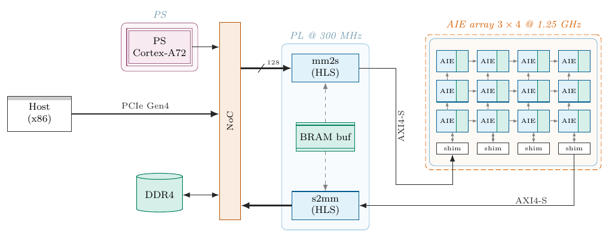

| Quantised GNN layer (`grey`) | Same figure (`okabe`) |
|---|---|
| 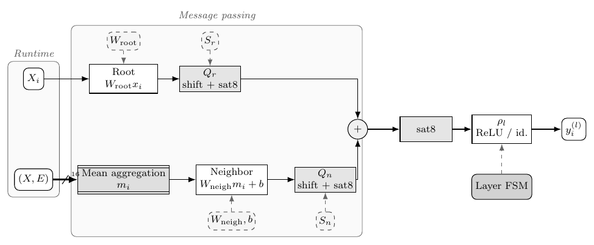 | 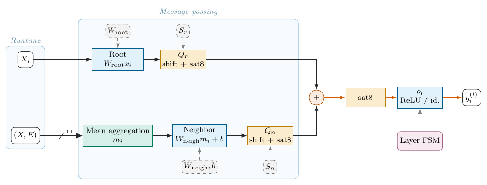 |

## Install

Copy `hwfig.sty` next to your `.tex` file (Overleaf: upload it to the
project), or install it for every document into your local tree:

```sh
mkdir -p "$(kpsewhich -var-value TEXMFHOME)/tex/latex/hwfig"
cp hwfig.sty "$(kpsewhich -var-value TEXMFHOME)/tex/latex/hwfig/"
```

Requires only TikZ and xcolor (any TeX Live / MiKTeX from the last decade).
It declares one extra pgf layer, `hwcanvas`, below `background`; if you call
`\pgfsetlayers` yourself, keep it in the list.

## Quick start

```latex
\usepackage[okabe]{hwfig}      % or [palette=okabe]; default is grey

\begin{tikzpicture}[hw]
  \node[runtime] (x)  at (0,0)   {$x$};
  \node[hlsbox]  (k)  at (2.2,0) {MAC};
  \node[qbox]    (q)  at (4.4,0) {shift + sat8};
  \node[ctime]   (w)  at (2.2,1.1) {$W$};
  \draw[arr]  (x) -- (k);
  \draw[hot]  (k) -- (q);
  \draw[darr] (w) -- (k);
\end{tikzpicture}
```

Always open the picture with `[hw]` (font, line width, arrow tips).

## Palettes

`\hwpalette{<name>}` switches palette anywhere; it is group-local, so it can
differ per figure.

| name | use |
|---|---|
| `grey` | print / journals (default) |
| `okabe` | Okabe–Ito, colour-blind safe, strongest contrast |
| `tol` | Paul Tol *muted*, colour-blind safe, softer |
| `bright` | Paul Tol *bright*, colour-blind safe, more saturated |
| `ibm` | IBM design palette, colour-blind safe |
| `nord` | cool tones, slides |
| `slate` | blue-grey + mauve + coral |
| `cern` | CERN blue with the orange accent of the CERN web theme |
| `ngt` | the five logo colours of CERN's Next Generation Triggers project |
| `ngtdark` | `ngt` on near-black, for slides — add `hwcanvas` to the picture |
| `ngtblue` | navy / teal / amber of the NGT title slides, on white |
| `ngtnight` | the same on the slides' navy — add `hwcanvas` |

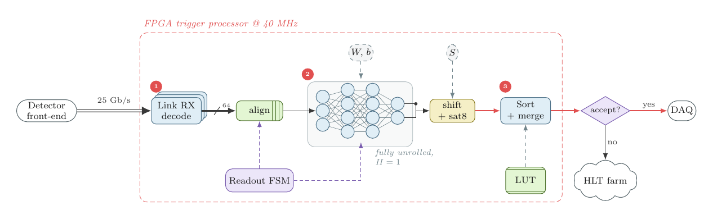

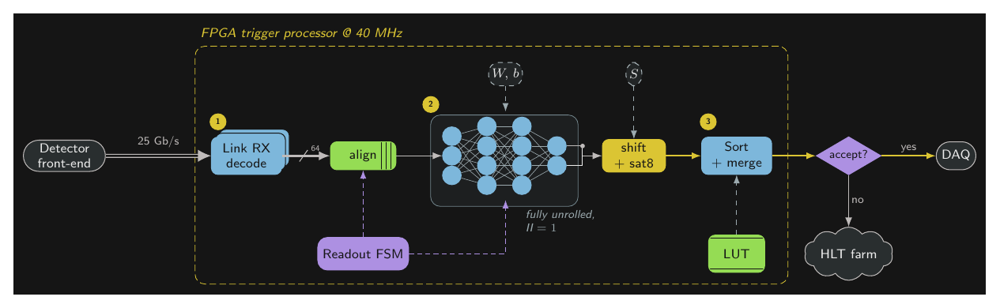

| `ngtblue` | `ngtnight` |
|---|---|
| 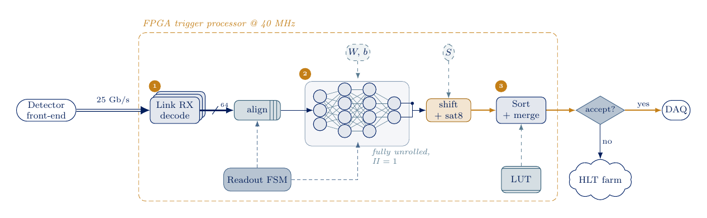 | 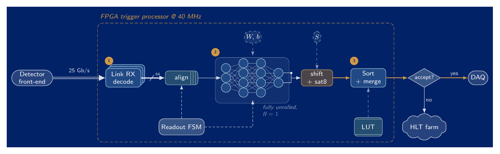 |

Custom palette — set all eight roles plus the wire colours:

```latex
\hwdefinepalette{mine}{%
  \hwrole{io}{black}{white}       \hwrole{comp}{teal}{teal!12}
  \hwrole{quant}{orange}{orange!15} \hwrole{const}{black!55}{black!4}
  \hwrole{op}{red!70!black}{red!10} \hwrole{mem}{blue!60!black}{blue!10}
  \hwrole{ctrl}{violet}{violet!10} \hwrole{group}{teal!40}{teal!3}
  \hwwires{black}{black!50}{red!70!black}}   % wire, constant wire, accent/hot
\hwpalette{mine}
```

Keep fills ≤ 25 % tint so black text stays readable. A dark palette also
sets `\hwink{<text>}{<paper>}` (default black on white); draw the picture
with `\begin{tikzpicture}[hw,hwcanvas]` to paint the paper colour behind it.

## Look: shapes, fills, fonts, line weight

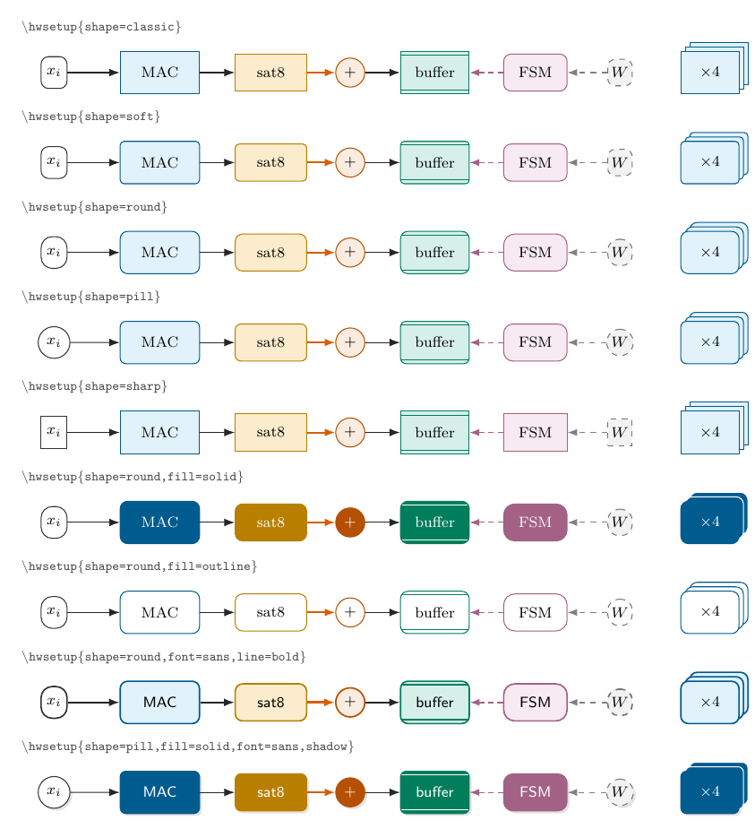

The look is independent of the palette. Everything is group-local, and
`\hwsetup` (or the package options) sets several things at once:

```latex
\usepackage[ngt,shape=round,font=sans]{hwfig}          % whole document
\hwsetup{palette=ngtdark,fill=solid,line=bold,shadow}  % from here on / this group
```

| command | values |
|---|---|
| `\hwshape{..}` | `classic` (default: square kernels, rounded ports), `soft`, `round`, `pill` (pill-shaped ports), `sharp` |
| `\hwfill{..}` | `tint` (default), `solid` (saturated boxes, white text — slides and posters), `outline` |
| `\hwfont{..}` | `serif`, `sans`, `mono`, or any font commands, e.g. `\hwfont{\sffamily\sansmath}` |
| `\hwline{..}` | `thin`, `normal`, `bold`, or a length |
| `\hwshadow` / `\hwshadow[false]` | soft drop shadow under boxes |

v1.1 figures render unchanged: the defaults are `classic`, `tint`, document
font, `normal`.

## Node and wire styles

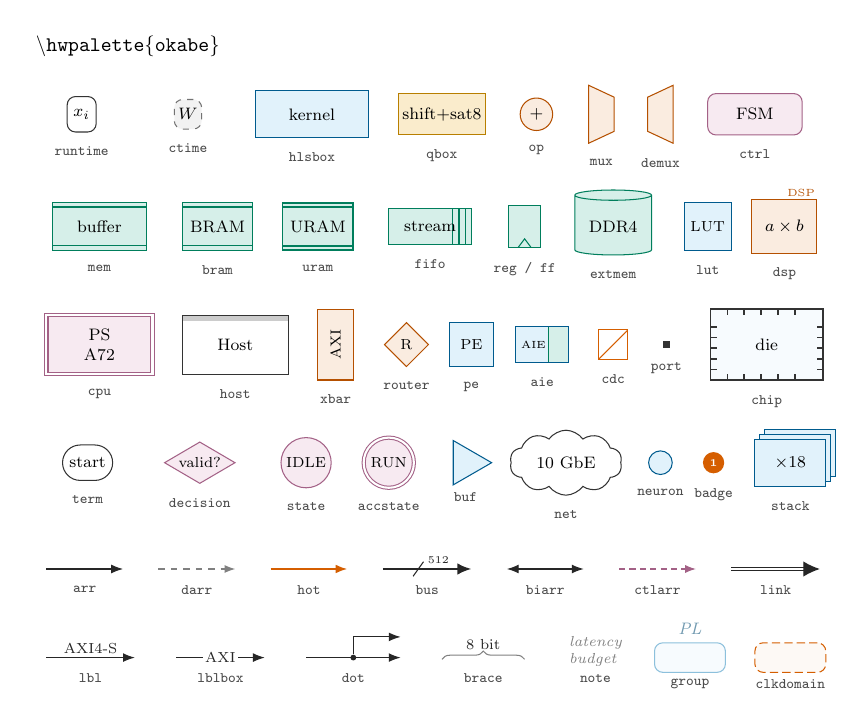

| style | use |
|---|---|
| `runtime` | run-time inputs / outputs, ports, tensors |
| `ctime` | compile-time constants: weights, scales, config (dashed) |
| `hlsbox` | compute kernel / HLS function / AIE kernel |
| `qbox` | quantiser, requant, shift + saturate |
| `op` | arithmetic operator (circle) |
| `mux`, `demux` | multiplexer / demultiplexer |
| `ctrl` | FSM, scheduler, controller |
| `mem`, `bram`, `uram`, `fifo`, `reg`/`ff` | on-chip storage |
| `extmem` | DDR / HBM |
| `lut`, `dsp` | FPGA primitives |
| `cpu`, `host`, `xbar`, `router`, `pe`, `aie`, `chip`, `port`, `cdc` | system blocks |
| `term`, `decision`, `state`, `accstate` | flow-chart terminator / branch, FSM state / accepting state |
| `buf`, `net`, `neuron` | buffer or driver (triangle), network cloud, neural-network unit |
| `stack` | add to any box for "N copies": `\node[hlsbox,stack]{$\times 18$};` |
| `group`, `plregion`, `psregion`, `clkdomain[=color]` | background frames (use with `fit`) |
| `grouplabel`, `lbl`, `lblbox`, `note`, `badge` | frame titles, wire labels (`lblbox` has a paper-coloured backing), free annotation, numbered call-out |
| `arr`, `darr`, `hot`, `bus` | wire, constant wire, highlighted path, wide bus |
| `biarr`, `ctlarr`, `link` | bidirectional wire, control / handshake, serial or optical link |
| `dot` | wire junction: `\node[dot] at (fork) {};` |
| `brace`, `brace'` | dimension brace: `\draw[brace] (a.north west) -- (a.north east) node[lbl,midway,above=5pt]{8 bit};` |

Bus width tick: `\draw[bus] (a) -- (b) pic[pos=.5]{buswidth=512};`
(`buswidth'` puts the number on the other side).

The same catalogue in every palette: `gallery/styles-1.png` … `styles-5.png`
(grey, okabe, tol, nord, slate) and `gallery/styles_more-1.png` …
`styles_more-7.png` (bright, ibm, cern, ngt, ngtdark, ngtblue, ngtnight).

## Parametric pics

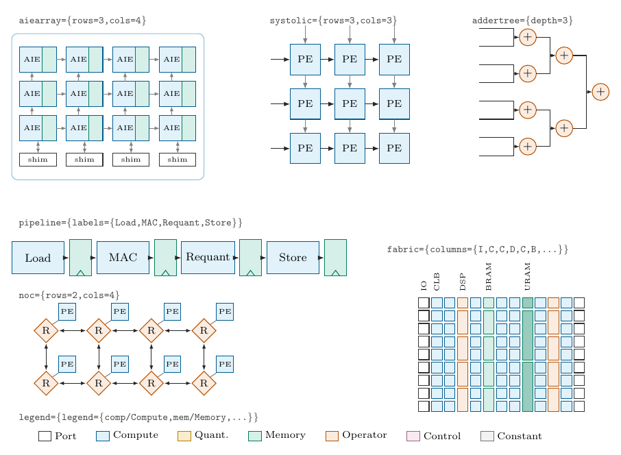

Options go straight into the pic, so two pics of different sizes can share a
picture:

```latex
\pic (A) at (0,0) {aiearray={rows=2,cols=4}};
\pic (B) at (6,0) {systolic={rows=3,cols=3}};
```

`\hwset{...}` sets defaults for the rest of the current scope instead.

| pic | keys | addressable parts |
|---|---|---|
| `aiearray` | `rows, cols, dx, dy, tilelabel` | tiles `(A-t<r>-<c>)` (r=1 bottom), shims `(A-s<c>)`, frame `(A-box)` |
| `systolic` | `rows, cols` | `(S-pe<r>-<c>)` (r=1 top) |
| `addertree` | `depth` (2^depth inputs) | inputs `(T-in<k>)`, adders `(T-a<level>-<k>)`, output `(T-out)` |
| `pipeline` | `labels={Load,MAC,...}` | stages `(P-st<k>)`, registers `(P-r<k>)` |
| `noc` | `rows, cols, nocpe` | routers `(N-n<r>-<c>)`, PEs `(N-pe<r>-<c>)` |
| `fabric` | `columns={I,C,D,B,U,...}, fabricrows` | column tops `(F-c<k>)` — C=CLB D=DSP B=BRAM U=URAM I=IO |
| `mlp` | `layers={3,5,5,2}, lsep, nsep` | units `(M-l<layer>-<k>)` (k=1 top) |
| `legend` | `legend={comp/Compute,mem/BRAM,...}` | roles: `io comp quant const op mem ctrl group` |

## Layout conventions

These keep figures across a paper looking like one family:

- Data flows left → right; parallel branches sit ±1.4 cm above/below.
- Compile-time constants (`ctime`) sit directly above/below the block they
  configure and connect with `darr`.
- Every block that changes precision is followed by a `qbox`.
- Branches merge with elbow wires that approach the `op` vertically:
  `\draw[arr] (a.east) -| ($(sum.north)+(0,0.32)$) -- (sum.north);`
- Frames go on the background layer:
  `\begin{scope}[on background layer]\node[group,fit=(a)(b),label={[grouplabel]above:PL}]{};\end{scope}`
- Place nodes with explicit coordinates; for dense dataflow it beats
  `positioning`. Keep figures ≤ 16 cm wide for two-column papers.
- Leave ≥ 0.6 cm between adjacent frames; nothing sits *on* a frame edge.
- Route wires between regions through an empty channel, each on its own
  level, ≥ 0.3 cm from parallel frame edges and block sides
  (see `examples/versal_soc.tex`).
- Put wire labels only on segments in free space — never where a wire
  crosses a frame border. On vertical runs rotate them:
  `node[lbl,rotate=90,below]{AXI4-S}`.

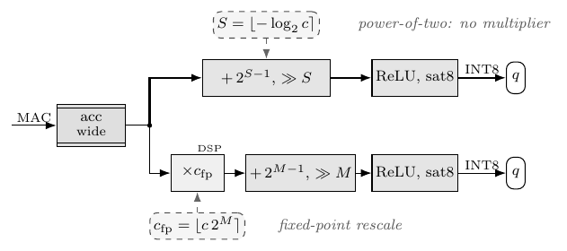

## Layout check

```latex
\usepackage[check]{hwfig}      % or \hwsetup{check} before a picture
```

While drafting, this warns in the log — and marks the spot in red in the
PDF — when two boxes overlap, a wire label sits on a box, a wire runs
through a box, or a wire is too short (or bends too late) for its arrow tip.
Each picture ends with `hwfig check: N problem(s)`. Add `nocheck` to a node
that overlaps on purpose. Remove the option for the final build.

## Examples and tests

`examples/` holds compilable standalone sources for every image above.
`sh build.sh` compiles all examples and the regression tests in `tests/` and
refreshes `gallery/` (needs `pdflatex` and `pdftoppm`; works with TeX Live
and MiKTeX without installing the package).

## Claude skill

`skill/SKILL.md` is a [Claude](https://claude.ai) skill that teaches
Claude to draw figures with this package: the visual grammar above, the style
and pic reference, common pitfalls, and a compile → inspect → fix loop.

```sh
sh skill/package.sh    # -> skill/tikz-hardware-figures.zip
```

Upload the zip in claude.ai under *Settings → Capabilities → Skills*. The zip
bundles the repository's `hwfig.sty`, so the skill always matches the package
version.

## Author

Pelayo Leguina — <pelayo.leguina.lopez@cern.ch>.
Bug reports and pull requests welcome.

## License

LaTeX Project Public License 1.3c or later — see [LICENSE](LICENSE).
